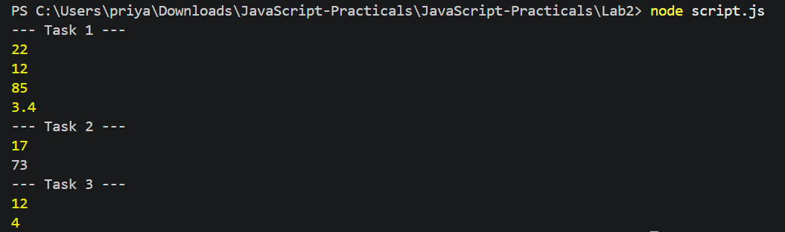

<!--
  Name: Priyanshi Sharma
  Roll No: BCS2025582
  Assignment: 2 - Operators, Type Conversion and a Calculator
-->

# Assignment 2: Operators, Type Conversion and a Calculator

**Name:** Priyanshi Sharma
**Roll No:** BCS2025582
**Subject:** JavaScript Programming Lab (BCS354), Invertis University, Bareilly

## Aim
Use arithmetic operators, convert between text and numbers, and use if and else if to choose an operation.

## Tasks
1. Sum, difference, product and quotient of 17 and 5.
2. Convert text `12` to a number and add 5; convert number 7 to text and join with `3`.
3. Calculator with if / else if for `+` and `-`.

## How to run
```bash
node script.js
```

## Output
```
--- Task 1 ---
22
12
85
3.4
--- Task 2 ---
17
73
--- Task 3 ---
12
4
```

## Screenshot

